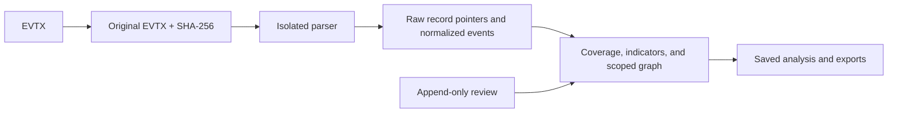

# PhantomTrace

PhantomTrace is a local investigation app for collected Windows event logs. It preserves each uploaded EVTX file by SHA-256, builds a searchable timeline with inspectable XML, and links observations through Windows session and process identifiers. Analysts can inspect the evidence for each relationship, trace it in either direction, and record review decisions with a reproducible before and after history.

## Run

From the repository root with Python 3.11 or newer:

```sh
python -m venv .venv
. .venv/bin/activate
python -m pip install -e .
make test
make demo
```

Open <http://127.0.0.1:8000/>. The demo creates three temporary cases using **synthetic XML**: an indicator chain, a benign control, and concurrent sessions. Select the indicator case, expand the candidate, inspect the graph, and open the session relationship to see its raw support. Reject the relationship to see which stages lose support. The scheduled task remains attached through its independent session evidence.

Start a persistent local workspace with `make run` instead. On Windows PowerShell, activate with `.venv\Scripts\Activate.ps1` and run `python -m uvicorn apps.api.main:app --host 127.0.0.1`. Keep the service bound to loopback. The MVP has no user authentication or case access controls.

## Investigate an EVTX case

1. Create a case and upload EVTX files. PhantomTrace uses the channel and provider embedded in each record. The filename is retained for custody.
2. Open **Boot ranges and logging policy** to supply any verified UTC boot intervals and policy references. Use timezone offsets in `start` and `end`, and a `reference` that explains how the single-boot interval was established. Ranges are inclusive at the start and exclusive at the end. Policy keys are shown in the coverage panel and documented in [the evaluation guide](docs/benchmarks/README.md).
3. Run analysis. Each incident candidate shows which stages have support and which remain unknown. Open an edge to see its matched field, scope, rule version, and source records.
4. Export the saved run as a CSV timeline, Markdown report, or JSON manifest. Reports and exports can be reproduced by analysis run ID. The OpenAPI console is available at `/docs`.



| Source | Normalized observations |
| --- | --- |
| Security | 4624 successful logon, 4625 failed logon, 4688 process creation, 4698 task registration |
| Sysmon | 1 process creation, 3 network connection, 11 file creation |
| PowerShell Operational | 4104 script block fragments |
| System | Kernel-General 12 startup boundaries |

**Correlation limits.** Cross-file hard links require a corroborated boot interval. PhantomTrace can derive one from consecutive Kernel-General startup records for the same host, or accept an analyst's independently verified range. Without a boot interval, ProcessGuid joins stay within one file and LogonId joins remain unresolved. Two candidate matches, contradicted accounts, and missing identifiers appear as gaps. A task's SubjectLogonId can associate its registration with a session. A process ID alone cannot identify the process that registered it. Endpoint file and network observations do not prove a transfer.

**Interpretation limits.** Native rules report observations. A chain candidate requires an encoded PowerShell observation linked to a session, a matching prior failure burst, and the documented time windows. A case can also contain a PowerShell candidate with missing stages. A scheduled task observation or missing telemetry alone says nothing about intent. The prototype keeps review history in SQLite and recomputes the saved case after review. It is a single analyst workbench.

**Evidence limits.** Ingest runs in a worker with a timeout and output bound, and with a memory limit where POSIX resource controls are available. Parse and analysis limits are 100 MiB per upload and 50,000 normalized events per case analysis. Read-only originals and database append-only rules protect against accidental changes through the app. Evidence custody still depends on controlling access to the local filesystem.

## Validation

The checked-in synthetic tests cover review history, concurrent session separation, the benign control, missing coverage, corrupt evidence, and exports. A separate parser smoke test replayed public Security and System EVTX files and repeated ingestion without new events. See the [benchmark guide](docs/benchmarks/README.md) for the measured counts and the labeled EVTX evaluation procedure. Your lab and held-out datasets are needed for scenario acceptance and any accuracy claims.
